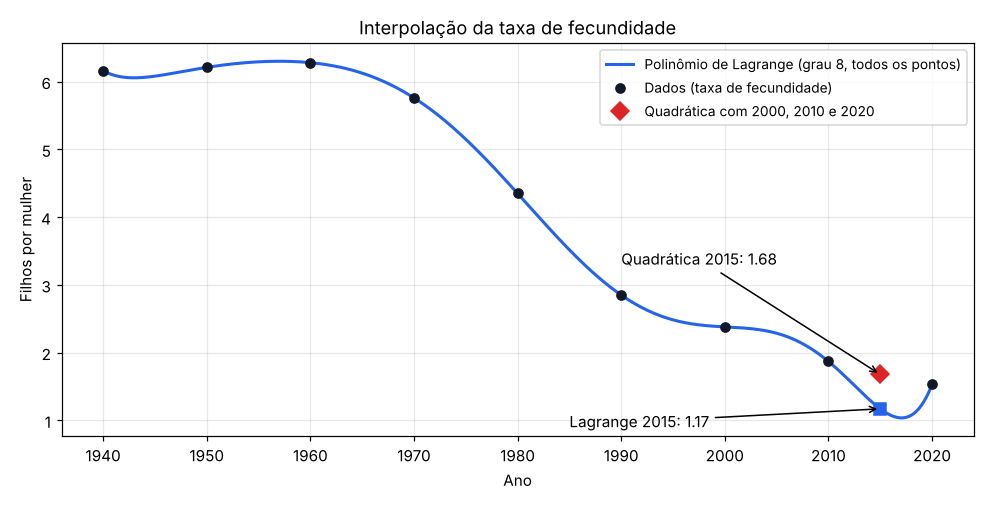

# Interpolação Polinomial: projeto final de Métodos Numéricos

Projeto final da disciplina de **Métodos Numéricos**. O programa lê uma série histórica da **taxa de fecundidade** (filhos por mulher, de 1940 a 2020) de uma planilha Excel e estima o valor em anos intermediários usando **quatro métodos de interpolação**, comparando resultado e tempo de execução.



*Com os 9 pontos, o polinômio de Lagrange tem grau 8 e oscila perto das bordas (fenômeno de Runge): para 2015 ele estima 1,17, abaixo dos dois vizinhos. Uma interpolação quadrática usando apenas 2000, 2010 e 2020 dá 1,68, valor mais plausível.*

## Métodos

| Arquivo | Método |
|---|---|
| `Lagrange.py` | Interpolação de **Lagrange** com todos os pontos |
| `Quadratica.py` | Interpolação **quadrática** com 3 pontos, resolvendo o sistema linear de forma **direta** ou **iterativa** |
| `DiferencasDivididas.py` | Polinômio de **Newton** com diferenças divididas |
| `DiferencasFinitas.py` | Polinômio de **Newton** com diferenças finitas (pontos igualmente espaçados) |
| `Metodos.py` | Solvers de sistemas lineares: eliminação direta e método iterativo de Jacobi |

> Na quadrática, a opção **iterativa** (Jacobi) não converge para esses dados: a matriz de Vandermonde formada pelos anos não é diagonalmente dominante. Use a opção **direta**.

Lagrange, diferenças divididas e diferenças finitas geram o mesmo polinômio interpolador; por isso os três dão o mesmo valor (1,1708 para 2015), mudando apenas o custo do cálculo.

## Dados

`Base de Dados.xlsx` tem duas colunas, `Ano` e `Fecundidade`, de 1940 a 2020, a cada 10 anos.

## Como executar

```bash
pip install -r requirements.txt
python main.py
```

O programa mostra os pontos conhecidos, pergunta o método e o ano, e imprime a estimativa e o tempo de execução. `main2.py` é uma variante que também salva os resultados em `auxiliar.xlsx`.

## Tecnologias

Python · NumPy · pandas

---

Projeto em grupo da disciplina de Métodos Numéricos (UNICAP). Repositório de [João Pedro Pimenta](https://www.linkedin.com/in/joao-pedro-pimenta/).
